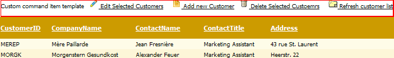

# Styling the CommandItem

To display the command item, set the **CommandItemDisplay** property of **GridTableView**. The property accepts **None**, **Top**, **Bottom**, or **TopAndBottom**. Customize the command item content with **GridTableView.CommandItemTemplate**.

> caption Figure 1: RadGrid CommandItemTemplate



The command item is rendered as a `tr.rgCommandRow` element with a `td.rgCommandCell` child. Apply background styles to the row and padding or borders to the cell:

````CSS
.RadGrid_WebBlue .rgCommandRow {
	background-image: none;
	background-color: red;
}

.RadGrid_WebBlue .rgCommandCell {
	padding: 12px 16px;
	background-image: none;
	background-color: white;
	border-top: 0;
	border-right: 0;
	border-bottom: 1px solid #9db6c5;
	border-left: 0;
}
````

The `.rgCommandRow` selector applies to the command item rows generated by the grid. If `CommandItemDisplay` is set to `TopAndBottom`, inspect the rendered HTML before adding an ancestor selector intended to target only the top command item. The exact placement can vary with the grid configuration and render mode.

>note If you are using the RadGrid skinning and want to customize the CommandItemTemplate, override the current `.rgCommandRow` and `.rgCommandCell` selectors for your skin. Declarative changes to the CommandItemTemplate do not override properties set in the skin.
>


## See Also

 * [Command Item Template]()
