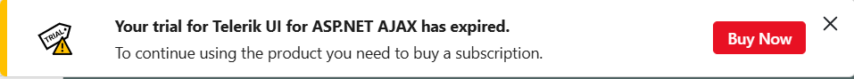
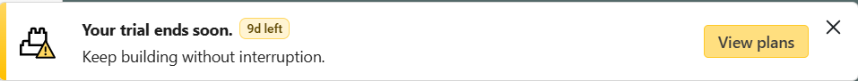

# License Activation Errors and Warnings

Starting with the 2025 Q1 release, using Telerik UI for ASP.NET AJAX without a license or with an invalid license causes specific license warnings and errors. This article defines what an invalid license is, explains what is causing it, and describes the related license warnings and errors.

## Invalid License

An invalid license can be caused by any of the following:

- Using an expired subscription license—subscription licenses expire at the end of the subscription term.
- Using a perpetual license for product versions released outside the validity period of your license.
- Using an expired trial license.
- A missing license for Telerik UI for ASP.NET AJAX.
- Not installing a license key in your application.
- Not updating the license key after renewing your Telerik UI for ASP.NET AJAX license.

### Banner

A banner with an action button appears on pages that use Telerik UI for ASP.NET AJAX components when the license is invalid, expired, or missing:

The colored accent bar on the left side of the banner and the action button reflect the severity of the message, for example, success, information, warning, or error. The title, message, and available action vary with the license status.

- Clicking the action button redirects you to start a trial, purchase, or renew your license, depending on your license status.
- Clicking the x (**Close**) button closes the banner. For messages that support snoozing, the banner and the related watermark do not reappear on page reload until the snooze period, which is determined by the licensing package, ends. The browser remembers this choice in its `localStorage`, so clearing the site data resets it. Messages that do not support snoozing appear again on the next page load.
- Activating a valid license removes the banner and the watermark.

### Trial Notices

When you use Telerik UI for ASP.NET AJAX with a valid trial license, a dismissible notice banner may appear without adding a watermark to the components. The banner can show the remaining trial days and an action to view plans.

The following examples illustrate trial notices for Telerik UI for ASP.NET AJAX.

The message, remaining-days badge, and available action vary with the trial stage. A trial notice does not indicate that license activation has failed.

## License Warnings and Errors

When using Telerik UI for ASP.NET AJAX in a project with an expired or missing license, the `Telerik.Licensing` build task will indicate the following errors:

| Error or Condition                                                       | Message Code       | Solution                                                                                                                                                            |
| ------------------------------------------------------------------------ | ------------------ | ------------------------------------------------------------------------------------------------------------------------------------------------------------------- |
| `No Telerik and Kendo UI License file found`                             | `TKL002`           | [Install a license key]() to activate the UI controls and remove the error message.                                                   |
| `Corrupted Telerik and Kendo UI License Key content in: [file path or environment variable name]`                     | `TKL003`           | If you use a telerik-license.txt file to activate the components, [download a new license key file](#downloading-the-license-key) and place it in your home directory. Make sure to use a license key and not a script key.    If you use the TELERIK_LICENSE environment variable to store your license key, [download a new license key](#downloading-the-license-key), update the content of the environment variable, and make sure it contains the entire key. |
| `Unable to locate licenses for all products`                             | `TKL004`           | Your license is not valid for all Telerik and Kendo products added to your project. If you have already purchased the required license, then .                      |
| `Corrupted Telerik and Kendo UI License Key content`                     | `TKL003`           | [Download a new license key](#downloading-the-license-key) and install it to activate the UI components and remove the error message. |
| `Telerik UI for ASP.NET AJAX is not listed in your current license file` | `TKL101`           | Review the purchase options for the listed products. Alternatively, remove the references to the listed packages from `package.json`.                               |
| `Your current license has expired`                                       | `TKL103`, `TKL104` | You are using a product version released outside the validity period of your perpetual license. To remove the error message, do either of the following:            |
|                                                                          |                    | - Renew your subscription and [download a new license key]()                                                                          |
|                                                                          |                    | - Downgrade to a product version included in your perpetual license as indicated in the message.                                                                    |
| `Your subscription has expired`                                          | `TKL103`, `TKL104` | Renew your subscription and [download a new license key]()                                                                            |
| `Your trial expired`                                                     | `TKL105`           | Purchase a commercial license to continue using the product.                                                                     |
| `No Telerik or Kendo UI product references detected in project.v.`       | `TKL001`           | - If you use Telerik products and see this message, update the `Telerik.Licensing` package to version 1.4.9 or later.                                                 |
|                                                                          |                    | - If you do not use Telerik products, remove the `Telerik.Licensing` NuGet reference from your project.                                                               |

## Runtime Errors

These errors appear when the application runs in the browser. Follow the linked articles to resolve them.

| Error                                                                    |  Solution                                                                                                                                                               |
| ------------------------------------------------------------------------ |  -------------------------------------------------------------------------------------------------------------------------------------------------------------------    |
| `No Telerik and Kendo UI License file found`                             |  [Resolving "No license found for Telerik UI for ASP.NET AJAX"]()                                                   |
| `We couldn't verify your license key for Telerik UI for ASP.NET AJAX`    |  [Resolving "No license found for Telerik UI for ASP.NET AJAX"]()                                                   |

## See Also

- [Setting Up Your License Key]()
- [Adding the License Key to CI Services]()
- [Frequently Asked Questions about Your Telerik UI for ASP.NET AJAX License Key]()
- [Resolving TelerikLicense.vb Build Error]()
